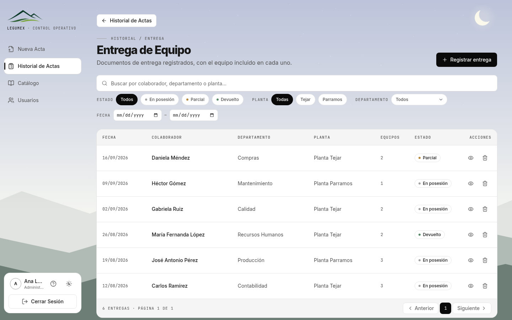
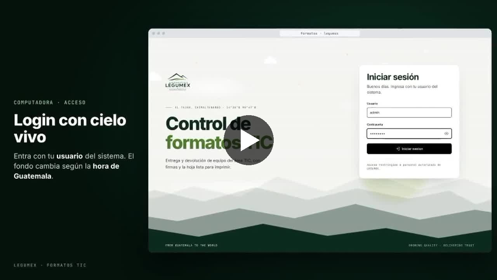
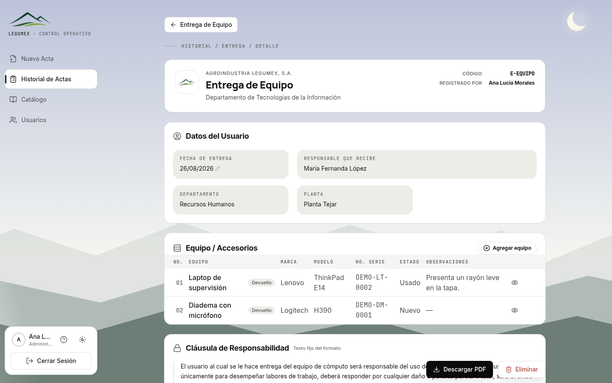
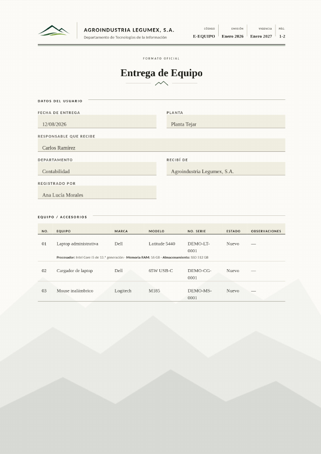
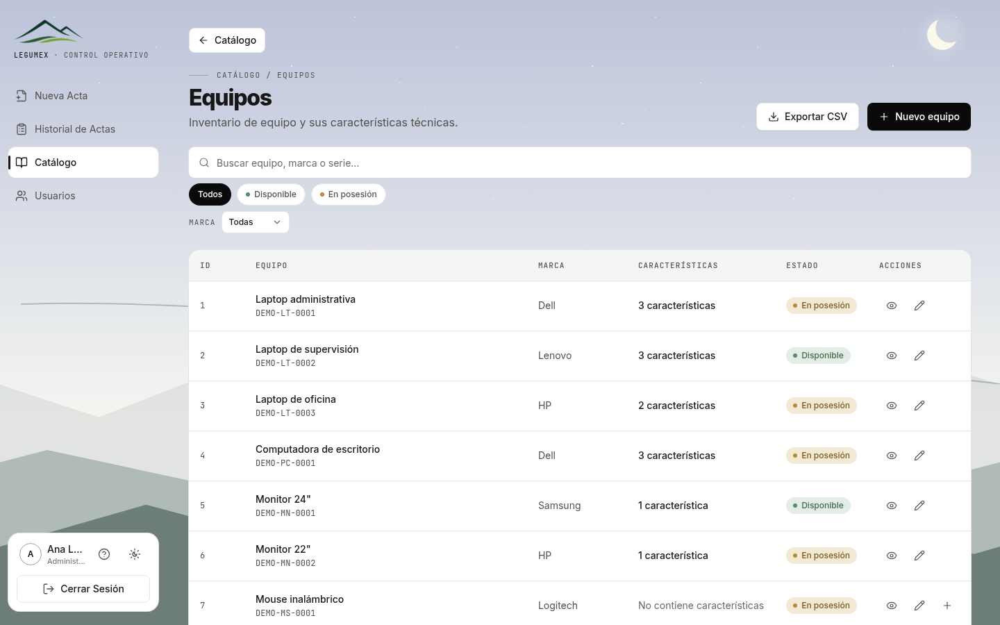
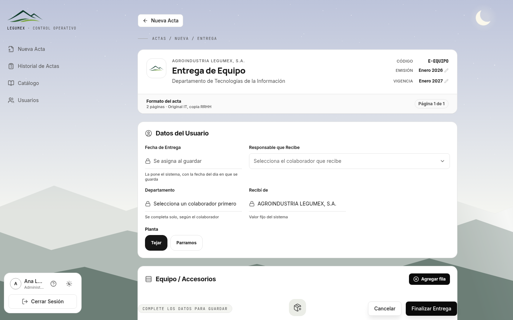
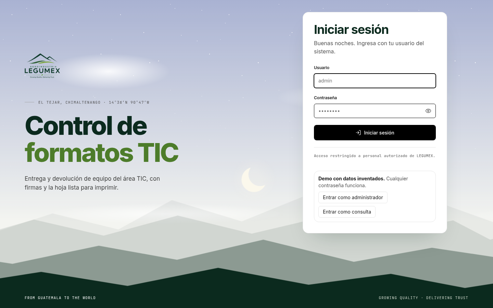
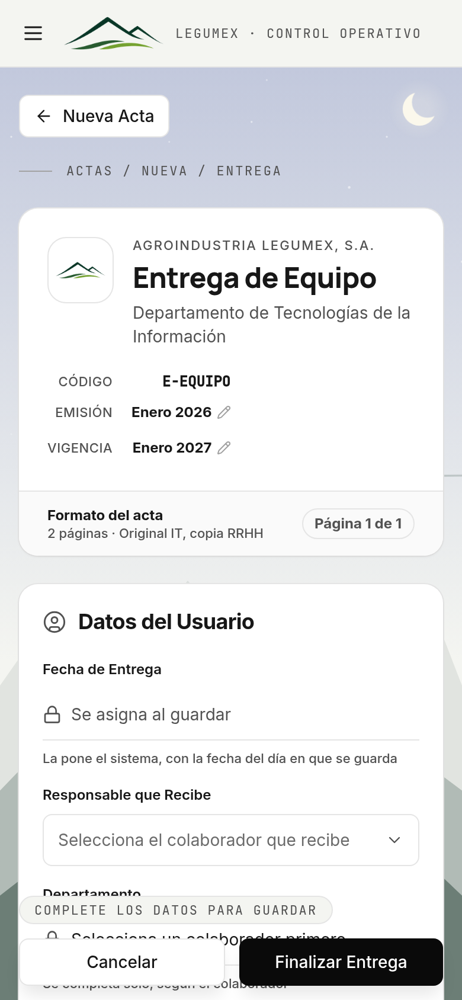

# Formatos TIC · Control de entregas y devoluciones de equipo

Sistema interno del área de TIC de Agroindustria Legumex para registrar la entrega y la devolución de equipo de cómputo, con firmas y actas listas para imprimir en PDF.

**🔗 Live demo:** https://formatos-tic-demo.vercel.app

> **Copia de demostración.** Este repositorio es una copia del frontend original ([Roberto-Santizo/leguemxapps_tic_formatos_frontend](https://github.com/Roberto-Santizo/leguemxapps_tic_formatos_frontend)) con un modo demostración agregado. Funciona sin servidor y con **datos inventados: no contiene información real de la empresa**.



## Video

Recorrido de menos de un minuto por las funciones principales (actas de entrega y devolución, firmas en pantalla, modo oscuro, permisos por rol y vista en el teléfono), con datos de demostración.

[](docs/video/formatos-tic-recorrido.mp4)

▶️ [Ver el video (MP4)](docs/video/formatos-tic-recorrido.mp4)

## Qué problema resuelve

Formatos TIC lleva el control de qué equipo tiene cada colaborador, en qué estado se entregó y cuándo se devolvió. Las actas reproducen la hoja física del departamento de TIC: se llenan en pantalla, se firman en el mismo dispositivo y se descargan en PDF con el formato oficial. El sistema quedó en uso en el área de TIC.

## Funcionalidades

- **Gestión de equipos**: inventario con marca, modelo, serie, tipo, estado **nuevo o usado** y características técnicas (procesador, memoria, almacenamiento).
- **Gestión de usuarios y colaboradores**: cuentas del sistema con rol y colaboradores con su área.
- **Entregas y devoluciones**: actas con firma del responsable y del encargado de TIC; las devoluciones pueden ser parciales.
- **Áreas y marcas**: catálogos de departamentos y fabricantes.
- **Actas en PDF** con el formato oficial, las firmas y las características de cada equipo.
- **Historial** por colaborador, por departamento y por equipo, con filtros por estado, planta, área y fecha.
- **Dos roles:** administrador (TIC: registra y corrige actas, catálogos y usuarios) y consulta (ve el historial y descarga los PDF).
- Diseño adaptado a computadora, tableta y teléfono, con modo oscuro y recorrido guiado.

## Capturas

| Acta de entrega | Acta en PDF |
|---|---|
|  |  |

| Inventario de equipos | Nueva entrega |
|---|---|
|  |  |

| Inicio de sesión | Teléfono |
|---|---|
|  |  |

## Cómo entrar a la demo

1. Abre la [demo](https://formatos-tic-demo.vercel.app).
2. Pulsa **"Entrar como administrador"** (o **"Entrar como consulta"**) y luego **"Iniciar sesión"**.

| Rol | Usuario | Contraseña |
|---|---|---|
| Administrador | `demo.admin` | cualquiera |
| Consulta | `demo.consulta` | cualquiera |

Todo lo que registres en la demo vive solo en tu navegador y se reinicia al recargar la página.

## Stack

- **Frontend (este repositorio):** React 18, Vite 5, React Router 7 y Tailwind CSS 3; jsPDF y html2canvas para las actas; firma en pantalla con react-signature-canvas.
- **Backend del sistema original:** API REST en Laravel con autenticación JWT ([legumexapps_tic_formatos_backend](https://github.com/Roberto-Santizo/legumexapps_tic_formatos_backend)).
- **Modo demostración:** `src/demo/` simula la API en el navegador con los mismos recursos y formatos de respuesta que el backend, sin enviar nada a ningún servidor.

## Cómo correrlo en local

Requisitos: Node.js 18 o superior.

```bash
npm install

# Demo con datos inventados (sin backend)
npm run dev:demo

# Contra la API real
cp .env.example .env   # VITE_AUTH_API_URL = base del backend (…/api)
npm run dev
```

`npm run build:demo` genera la versión de demostración en `dist/` (es la que publica Vercel, ver `vercel.json`).

## Mi rol

Participé como desarrollador y colaborador en mi práctica profesional en el área de TIC de Agroindustria Legumex (agosto a septiembre de 2026). En esta copia agregué el modo demostración con datos inventados para poder mostrar el sistema públicamente.

## Más documentación

Los documentos técnicos del proyecto original se conservan: [`CONTEXTO_SISTEMA_DISENO_REGLAS.md`](CONTEXTO_SISTEMA_DISENO_REGLAS.md), [`CLAUDE.md`](CLAUDE.md), [`GUIA_DESPLIEGUE_UBUNTU.md`](GUIA_DESPLIEGUE_UBUNTU.md) y [`paginacion.md`](paginacion.md).
